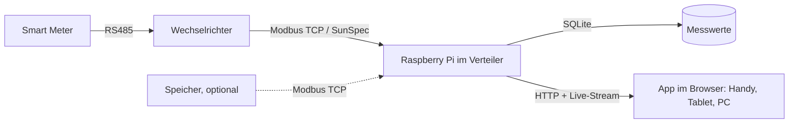

# Konzept: Solarmaa Energie-Dashboard

## Idee in einem Satz

Ein kleiner Raspberry Pi, den Solarmaa bei jeder neuen Anlage im Verteiler auf die Hutschiene setzt. Er liest Wechselrichter und Zähler lokal aus und zeigt dem Kunden auf Handy, Tablet oder PC seine Anlage live, im Solarmaa-Design.

## Warum

| Für den Kunden | Für Solarmaa |
|---|---|
| Sieht auf einen Blick: Produktion, Verbrauch, Netz, Batterie | Markenauftritt bei jedem Blick des Kunden in die App |
| Eine App statt Hersteller-Portal mit Login | Gleiche Kunden-Erfahrung, egal welcher Wechselrichter verbaut ist |
| Funktioniert ohne Internet und ohne Cloud-Konto | Grundlage für Service: Ausfälle erkennen, bevor der Kunde anruft (Ausbaustufe 2) |
| Eigenverbrauch und Autarkie verständlich erklärt | Verkaufsargument in der Offerte, Vorführgerät im Demo-Modus |

## Was die App zeigt (Version 1)

1. **Energiefluss jetzt:** Solar → Haus, Netz (Bezug oder Einspeisung), Batterie (lädt / entlädt, Ladezustand). Animierte Linien, Geschwindigkeit nach Leistung.
2. **Heute:** produziert, verbraucht, eingespeist, vom Netz bezogen (kWh) sowie Eigenverbrauch und Autarkie in Prozent, mit einem Satz Erklärung.
3. **Verlauf:** Tageskurve (Produktion vs. Verbrauch in kW, 5-Minuten-Werte), Woche, Monat, Jahr als Balken (kWh). Blättern in die Vergangenheit.
4. **Optional:** Ersparnis in CHF und vermiedenes CO₂, aber nur, wenn Tarif bzw. Faktor pro Kunde hinterlegt sind. Ohne Wert zeigt die App nichts an, statt zu schätzen.
5. **Fusszeile:** Anlagengrösse, Inbetriebnahme, Gesamtproduktion, Kontakt Solarmaa.

## Design

Farben und Schrift stammen direkt aus den Variablen der Webflow-Seite solarmaa.ch (ausgelesen am 10.11.2026):

| Rolle in der App | Webflow-Variable | Wert |
|---|---|---|
| Marke, Tabs, Autarkie-Ring | Accent Primary | `#b279d7` |
| Solarproduktion | Text Accent | `#FF6B00` |
| Hover / Einspeisung | Accent Primary Hover | `#ff8f3d` |
| Netz (abgedunkelt für Kontrast) | BG Accent Secondary | `#adb8e7` → `#5566b8` |
| Batterie / Demo-Band | BG Accent Tertiary | `#ceebad` → `#5a9a2e` |
| Text, Dunkelmodus-Fläche | Neutral Inverse | `#212325` |
| Schrift | Heading/Body Font | Inter |

Die hellen Akzentfarben (`#adb8e7`, `#ceebad`) sind auf Weiss als Linien zu schwach. Die App nutzt dafür dunklere Töne aus derselben Farbfamilie und die Originale als Flächen. Hell- und Dunkelmodus folgen der Einstellung des Geräts.

Alle Farben stehen als Variablen oben in `app/style.css`. Ändert sich das Webflow-Design, passt man sie dort an.

## Aufbau

- **Pi-Software** (`pi/solarmaa_dash`): Python 3, keine Zusatzpakete. Fragt alle 5 Sekunden ab, speichert Minutenwerte und Tagessummen in SQLite (Standard 800 Tage), liefert App und JSON-API auf Port 80.
- **App** (`app/`): eine Webseite ohne Build-Schritt und ohne Internet-Abhängigkeit. Lässt sich auf dem Handy «Zum Startbildschirm hinzufügen» und verhält sich dann wie eine App.
- **Datenquelle:** SunSpec über Modbus TCP. Das ist der herstellerübergreifende Standard, den viele Wechselrichter und Zähler sprechen. Ein `scan`-Befehl zeigt bei der Inbetriebnahme, was das Gerät liefert.
- **Demo-Modus:** simulierte Anlage für Werkstatt, Messe und Verkaufsgespräch. Die App zeigt dann deutlich ein Demo-Band.

## Kompatibilität

Version 1 unterstützt Geräte mit SunSpec-Modellen 101–103 (Wechselrichter, «int + SF»), 201–204 (Zähler) und 124 (Ladezustand Speicher). Welche Hersteller und Firmware-Stände das konkret erfüllen, muss pro Gerätetyp einmal mit `scan` geprüft und in der Tabelle in [04-inbetriebnahme.md](04-inbetriebnahme.md) nachgetragen werden.

Nicht in Version 1:
- Hersteller ohne SunSpec über Modbus TCP (eigene Registerkarten). Dafür braucht es pro Hersteller einen kleinen Adapter in `sources.py`.
- Float-Modelle 111–113.
- Batterie-Leistung bei Hybrid-Wechselrichtern: Ladezustand ja, Lade-/Entladeleistung erst mit Hersteller-Adapter. Der Hausverbrauch stimmt trotzdem, weil er aus Wechselrichter-AC-Leistung und Netzzähler gerechnet wird.

## Sicherheit und Datenschutz

- Alles bleibt im Kundennetz. Keine Cloud, kein Konto, keine Daten an Solarmaa.
- Der Pi liest nur (Modbus Funktion 3). Er schreibt nichts in Wechselrichter oder Zähler.
- Kein Portforwarding im Router. Wer im WLAN des Kunden ist, kann die Werte sehen; für Version 1 ist das bewusst so einfach gehalten.
- Der Dienst läuft als eigener Benutzer ohne Root-Rechte, mit Hardware-Watchdog und begrenzter Log-Grösse.

## Ausbaustufen

| Stufe | Inhalt |
|---|---|
| 2 – Service | Pi meldet «Anlage produziert nicht / Gerät nicht erreichbar» an Solarmaa (z. B. per Mail über die geplante Mail-API). Fernwartung über VPN (z. B. Tailscale) für Updates. |
| 3 – Unterwegs | Kunde sieht die App auch ausserhalb des Hauses, über einen Solarmaa-Server oder VPN. Dann mit Login. |
| 4 – Steuern | Überschuss nutzen: Warmwasser, Wallbox, Wärmepumpe (SG-Ready) über Relais oder Modbus-Schreiben. Benötigt eigene Sicherheitsprüfung. |
| 5 – Weitere Hersteller | Adapter für Geräte ohne SunSpec. |

## Offene Entscheide für Solarmaa

- Wird das Gerät verkauft, in die Offerte eingerechnet oder als Service-Abo angeboten?
- Welche Hersteller verbaut Solarmaa am häufigsten? Diese zuerst mit `scan` testen und freigeben.
- Soll der Kunde die App auch unterwegs sehen (Stufe 3)? Das ändert Datenschutz und Betrieb.
- Tarif- und CO₂-Werte: zentral pro Netzbetreiber pflegen oder pro Kunde eintragen?
