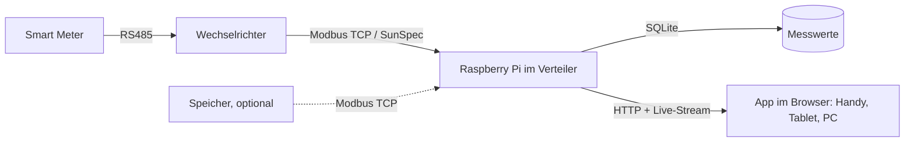

# Konzept: Solarmaa Energie-Dashboard

## Idee in einem Satz

Ein kleiner Raspberry Pi, den Solarmaa bei jeder neuen Anlage im Verteiler auf die Hutschiene setzt. Er liest Wechselrichter und Zähler lokal aus und zeigt dem Kunden auf Handy, Tablet oder PC seine Anlage live, im Solarmaa-Design.

## Warum

| Für den Kunden | Für Solarmaa |
|---|---|
| Sieht auf einen Blick: Produktion, Verbrauch, Netz, Batterie | Markenauftritt bei jedem Blick des Kunden in die App |
| Eine App statt Hersteller-Portal mit Login | Gleiche Kunden-Erfahrung, egal welcher Wechselrichter verbaut ist |
| Funktioniert ohne Internet und ohne Cloud-Konto | Grundlage für Service: Ausfälle erkennen, bevor der Kunde anruft (Ausbaustufe 2) |
| Eigenverbrauch und Autarkie verständlich erklärt | Verkaufsargument in der Offerte, Vorführgerät im Demo-Modus |

## Was die App zeigt (Version 1)

1. **Energiefluss jetzt:** Solar → Haus, Netz (Bezug oder Einspeisung), Batterie (lädt / entlädt, Ladezustand). Animierte Linien, Geschwindigkeit nach Leistung.
2. **Heute:** produziert, verbraucht, eingespeist, vom Netz bezogen (kWh) sowie Eigenverbrauch und Autarkie in Prozent, mit einem Satz Erklärung.
3. **Verlauf:** Tageskurve (Produktion vs. Verbrauch in kW, 5-Minuten-Werte), Woche, Monat, Jahr als Balken (kWh). Blättern in die Vergangenheit.
4. **Optional:** Ersparnis in CHF und vermiedenes CO₂, aber nur, wenn Tarif bzw. Faktor pro Kunde hinterlegt sind. Ohne Wert zeigt die App nichts an, statt zu schätzen.
5. **Fusszeile:** Anlagengrösse, Inbetriebnahme, Gesamtproduktion, Kontakt Solarmaa.

## Design

Farben und Schrift stammen direkt aus den Variablen der Webflow-Seite solarmaa.ch (ausgelesen am 10.11.2026):

| Rolle in der App | Webflow-Variable | Wert |
|---|---|---|
| Marke, Tabs, Autarkie-Ring | Accent Primary | `#b279d7` |
| Solarproduktion | Text Accent | `#FF6B00` |
| Hover / Einspeisung | Accent Primary Hover | `#ff8f3d` |
| Netz (abgedunkelt für Kontrast) | BG Accent Secondary | `#adb8e7` → `#5566b8` |
| Batterie / Demo-Band | BG Accent Tertiary | `#ceebad` → `#5a9a2e` |
| Text, Dunkelmodus-Fläche | Neutral Inverse | `#212325` |
| Schrift | Heading/Body Font | Inter |

Die hellen Akzentfarben (`#adb8e7`, `#ceebad`) sind auf Weiss als Linien zu schwach. Die App nutzt dafür dunklere Töne aus derselben Farbfamilie und die Originale als Flächen. Hell- und Dunkelmodus folgen der Einstellung des Geräts.

Alle Farben stehen als Variablen oben in `app/style.css`. Ändert sich das Webflow-Design, passt man sie dort an.

## Aufbau

- **Pi-Software** (`pi/solarmaa_dash`): Python 3, keine Zusatzpakete. Fragt alle 5 Sekunden ab, speichert Minutenwerte und Tagessummen in SQLite (Standard 800 Tage), liefert App und JSON-API auf Port 80.
- **App** (`app/`): eine Webseite ohne Build-Schritt und ohne Internet-Abhängigkeit. Lässt sich auf dem Handy «Zum Startbildschirm hinzufügen» und verhält sich dann wie eine App.
- **Datenquelle:** SunSpec über Modbus TCP. Das ist der herstellerübergreifende Standard, den viele Wechselrichter und Zähler sprechen. Ein `scan`-Befehl zeigt bei der Inbetriebnahme, was das Gerät liefert.
- **Demo-Modus:** simulierte Anlage für Werkstatt, Messe und Verkaufsgespräch. Die App zeigt dann deutlich ein Demo-Band.

## Kompatibilität: ein Pi für alle Anlagen

Der Pi kombiniert beliebig viele Geräte. Jedes bekommt eine Rolle (PV, Netz, Speicher oder «anlage» für Geräte, die alles liefern). Die Geräteerkennung (`erkennen`) schlägt die Konfiguration automatisch vor.

| Weg | Geräte | Stand |
|---|---|---|
| SunSpec über Modbus TCP | Wechselrichter, Zähler und Speicher vieler Hersteller (z. B. SMA, SolarEdge, Kostal, Fronius) | mit simuliertem Gerät getestet, pro Hersteller an echter Anlage prüfen |
| Fronius Solar API (HTTP) | Fronius mit Datamanager oder GEN24, auch ohne Modbus | Batterie-Vorzeichen bei der ersten Anlage prüfen |
| Registerprofil (Modbus TCP) | Huawei SUN2000, GoodWe ET/EH, Sigenergy; weitere als Profil-Datei ohne Programmierung | Profile nach Herstellerdoku bzw. Open-Source-Integrationen, **ungeprüft** |
| Shelly (lokal, HTTP) | Pro 3EM, 3EM, EM, Pro EM, Plus PM, Pro 4PM u. a., Gen1 bis Gen4 | Feldnamen nach Shelly-API, an echtem Gerät prüfen |
| smart-me | Cloud-API (API-Key), lokal per Modbus TCP vorbereitet | Feldnamen aus Community-Beispielen, beim ersten Konto prüfen |

**Damit wirklich jede Marke geht:** Spricht ein Wechselrichter kein unterstütztes Protokoll, misst ein Shelly Pro 3EM oder ein smart-me-Zähler am PV-Abgang und einer am Netzanschluss. Dann ist die Marke egal. Nur der Batterie-Ladezustand fehlt in diesem Fall, bis es ein Profil gibt.

**GoodWe:** Viele GoodWe-Dongles sprechen Modbus nur über UDP (Port 8899), nicht über Modbus TCP. Das Profil funktioniert nur mit Geräten, die Modbus TCP auf Port 502 anbieten. Sonst den Messweg über Shelly oder smart-me nutzen.

## Haus und Abrechnung

Für Mehrfamilienhäuser und ZEV: Hausskizze mit anklickbaren Einheiten und Zählern, Login mit Rollen (Solarmaa, Verwaltung, Mieter), Rechnungen aus smart-me. Details in [06-haus-und-abrechnung.md](06-haus-und-abrechnung.md).

## Wartung

Web-Updates mit Testlauf und automatischem Zurückfallen, Gerätestatus und Geräteerkennung im Browser, Fernzugriff über VPN. Details in [07-wartung-und-updates.md](07-wartung-und-updates.md).

## Sicherheit und Datenschutz

- Alles bleibt im Kundennetz. Keine Cloud, kein Konto, keine Daten an Solarmaa.
- Der Pi liest nur (Modbus Funktion 3). Er schreibt nichts in Wechselrichter oder Zähler.
- Kein Portforwarding im Router. Das Anlagen-Dashboard sieht jeder im Heimnetz. Daten einzelner Einheiten, Rechnungen und Berechtigte nur mit Login und passender Rolle.
- Ausnahme Cloud: smart-me-Zähler über die Cloud-API holen ihre Werte bei smart-me ab.
- Der Dienst läuft als eigener Benutzer ohne Root-Rechte, mit Hardware-Watchdog und begrenzter Log-Grösse.

## Ausbaustufen

| Stufe | Inhalt |
|---|---|
| 2 – Service | Pi meldet «Anlage produziert nicht / Gerät nicht erreichbar» an Solarmaa (z. B. per Mail über die geplante Mail-API). Web-Updates und Fernzugriff sind bereits vorbereitet. |
| 3 – Unterwegs | Kunde sieht die App auch ausserhalb des Hauses, über einen Solarmaa-Server oder VPN. Dann mit Login. |
| 4 – Steuern | Überschuss nutzen: Warmwasser, Wallbox, Wärmepumpe (SG-Ready) über Relais oder Modbus-Schreiben. Benötigt eigene Sicherheitsprüfung. |
| 5 – Weitere Hersteller | Weitere Registerprofile; GoodWe über UDP; Rechnungen direkt aus smart-me, sobald es eine API gibt. |

## Offene Entscheide für Solarmaa

- Wird das Gerät verkauft, in die Offerte eingerechnet oder als Service-Abo angeboten?
- Welche Hersteller verbaut Solarmaa am häufigsten? Diese zuerst mit `geraet-test` an einer echten Anlage prüfen und das Profil auf `geprueft = true` setzen.
- smart-me: Professional-Lizenz für die Cloud-API klären und nachfragen, ob es eine Rechnungs-API gibt.
- Soll der Kunde die App auch unterwegs sehen (Stufe 3)? Das ändert Datenschutz und Betrieb.
- Tarif- und CO₂-Werte: zentral pro Netzbetreiber pflegen oder pro Kunde eintragen?
