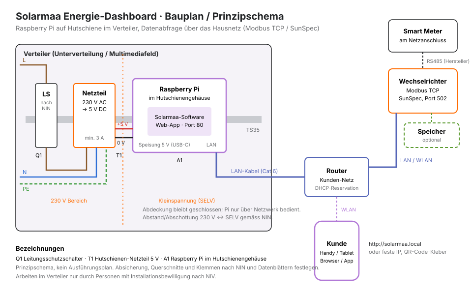

# Bauplan: Hardware

Das Schema ist ein Prinzipschema, kein Ausführungsplan. Absicherung, Querschnitte, Klemmen und Abstände legt die ausführende Fachperson nach NIN und den Datenblättern der gewählten Produkte fest.

## Stückliste pro Anlage

Produktwahl und Preise beim Grossisten prüfen. Die Angaben unten sind Anforderungen, keine Bestellnummern.

| Pos. | Bauteil | Anforderung | Menge |
|---|---|---|---|
| A1 | Raspberry Pi 4 Model B, 2 GB | Reicht für die Software. Pi 5 geht auch, braucht aber mehr Strom und wird wärmer. | 1 |
| A1 | Hutschienengehäuse für den gewählten Pi | TS35-Montage, Belüftungsschlitze, Zugang zu LAN und USB-C | 1 |
| A1 | microSD-Karte, «Industrial» oder «High Endurance», 32 GB | für Dauerbetrieb ausgelegt | 1 |
| T1 | Hutschienen-Netzteil 230 V AC → 5 V DC | mindestens 3 A, Ausgangsspannung einstellbar (auf ca. 5.1 V stellen); z. B. Mean Well HDR-30-5, Werte laut Datenblatt prüfen | 1 |
| – | Kabel USB-C mit offenen Enden (oder USB-C-Klemmadapter) | für 3 A ausgelegt, möglichst kurz | 1 |
| Q1 | Leitungsschutzschalter | Bemessung nach NIN und Datenblatt Netzteil (Einschaltstrom beachten); oder Abgang über bestehenden passenden Stromkreis | 1 |
| – | Patchkabel Cat 6, ggf. Verlegekabel und Dose | Pi ↔ Router | nach Bedarf |
| – | Etikett / QR-Code-Kleber | Adresse der App für den Kunden | 1 |

Optional, je nach Anlage:
- **Kleine USV-Lösung oder Supercap-Modul** für sauberes Herunterfahren bei Stromausfall. Bei Einsatz von Industrie-SD-Karte und Watchdog meist nicht nötig.
- **Industrie-Variante:** Hutschienen-Rechner auf Raspberry-Pi-Basis mit 24 V-Eingang und spezifiziertem Temperaturbereich (z. B. Revolution Pi von Kunbus). Teurer, dafür als Industriegerät zertifiziert. Die Software läuft darauf ohne Änderung.

## Platzbedarf

Netzteil und Pi-Gehäuse nebeneinander auf der Hutschiene, plus Q1. Die genaue Anzahl Teilungseinheiten hängt von den gewählten Produkten ab (Datenblätter). Grob mit einer halben Reihe in einem Verteiler oder Multimediafeld rechnen.

## Umgebung

- **Temperatur:** Der Raspberry Pi 4 ist im Produktdatenblatt für 0–50 °C Umgebungstemperatur angegeben. In einem geschlossenen Verteiler mit vielen Geräten kann es wärmer werden. Gehäuse mit Belüftung wählen, nicht direkt über Wärmequellen (z. B. Wechselrichter, Schütze unter Last) montieren. Die CPU-Temperatur lässt sich später mit `vcgencmd measure_temp` kontrollieren.
- **Feuchte:** nur in trockenen Innenräumen.
- **Netzwerk:** LAN-Kabel bevorzugen. WLAN aus einem Metallverteiler ist unzuverlässig. Gibt es kein Kabel zum Router, Powerline oder einen kleinen Switch im Multimediafeld prüfen.

## Verdrahtung

1. Zuleitung über Q1 auf den Eingang von T1 (L, N, PE nach Datenblatt).
2. Ausgang T1 (+V / −V) über das USB-C-Kabel auf den Pi. Polung prüfen, bevor der Pi angeschlossen wird.
3. 230 V und Kleinspannung räumlich trennen; Abdeckung geschlossen.
4. LAN-Kabel vom Pi zum Router oder Switch.

Den Pi **nicht** über die GPIO-Pins speisen: Die USB-C-Buchse hat eine Schutzschaltung, die GPIO-Speisung nicht.

## Warum Raspberry Pi und nicht ein Fertiggerät

- Gleiche Hardware und gleiche App für alle Hersteller.
- Teile bei vielen Lieferanten erhältlich, schnell ersetzbar: Bei Defekt einfach neue SD-Karte mit gespeicherter Konfiguration einsetzen.
- Volle Kontrolle über Design und Funktionen, kein Abo bei Drittanbietern.
