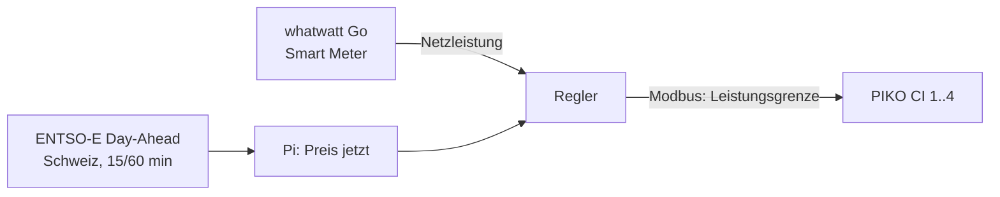

# Abregelung bei negativen Strompreisen (Feldtest PIKO CI)

Ziel: Bei negativem Day-Ahead-Preis speist die Anlage nichts ins Netz ein. Sie produziert weiter für den Eigenverbrauch («Nulleinspeisung»). Sobald der Preis wieder positiv ist, laufen die Wechselrichter wieder voll.

Feldtest-Anlage: 4 × Kostal PIKO CI 60 (240 kW), Netzanschluss gemessen mit whatwatt Go am Smart Meter des Netzbetreibers.

## Wie es funktioniert



1. Der Pi holt einmal täglich nach 13 Uhr die Preise für morgen (ENTSO-E, Gebotszone Schweiz) und speichert sie.
2. Liegt der Preis der aktuellen Viertelstunde unter der Schwelle (Standard 0 €/MWh), regelt der Pi:
   - Ziel ist ein kleiner Netzbezug (`puffer_w`, Standard 500 W), damit sicher nichts eingespeist wird.
   - Alle 10 Sekunden passt er die Gesamtgrenze an und verteilt sie nach Nennleistung auf die Wechselrichter.
3. Ist der Preis wieder positiv, setzt er alle Wechselrichter auf Nennleistung.

**Sicherheitsregeln im Programm:**
- Fällt der Netzzähler länger als 60 s aus, gibt der Pi frei: lieber kurz einspeisen als ohne Messung blind regeln.
- Beim Beenden des Dienstes (Update, Neustart) gibt er ebenfalls frei.
- Er schreibt nur bei Änderungen über 1 kW oder als Lebenszeichen alle 60 s, nicht im Sekundentakt.

## Wichtig vor dem Feldtest

1. **PIKO-CI-Register prüfen.** Die Register stammen aus Auszügen der Kostal-Schnittstellenbeschreibung «PIKO CI Interface description KOSTAL MODBUS (TCP) with control information»:
   - `0x30B3` (12467) «Power limit function» = 1 «External device»
   - `0x3085` (12421) «Output power de-rating by Modbus command», Watt, U32

   Das vollständige PDF konnte ich nicht lesen. Vor dem ersten Schreiben mit dem aktuellen Kostal-PDF für die installierte Firmware vergleichen (`pi/solarmaa_dash/profile/kostal_piko_ci.toml`). Klären:
   - Bedeutet «External device» wirklich Steuerung über Modbus?
   - Welche Wortfolge gilt für U32?
   - Was macht der Wechselrichter, wenn kein Befehl mehr kommt?
   - Bleibt die Vorgabe nach einem Neustart des Wechselrichters erhalten?
2. **Netzbetreiber:** Bei 240 kW hat der Netzbetreiber meist eigene Vorgaben (Rundsteuerung, Leistungsreduktion). Diese haben Vorrang und dürfen nicht übersteuert werden. Den Feldtest mit dem Netzbetreiber absprechen.
3. **Tarif und Preis:** Der Kunde wird ab nächstem Jahr pro Viertelstunde vergütet bzw. belastet. Massgebend ist der Preis seines Netzbetreibers bzw. Vermarkters. Der Day-Ahead-Preis ist nur die Grundlage dafür. Weicht der Tarif ab (Zuschläge, eigene Formel), die Schwelle anpassen oder die Preise des Netzbetreibers als CSV einspielen (`preisquelle = "csv"`).
4. **ENTSO-E-Token:** Kostenlos. Konto auf transparency.entsoe.eu anlegen, dann per Mail an transparency@entsoe.eu den API-Zugang («Restful API access») beantragen. Den Token erzeugst du danach in den Kontoeinstellungen. Ob ENTSO-E die Schweizer Preise im 15- oder 60-Minuten-Raster liefert, zeigt `python3 -m solarmaa_dash preise`.
5. **whatwatt:** Kundenschnittstelle beim Netzbetreiber freischalten lassen, whatwatt mit der Rolle `netz` eintragen und mit `geraet-test` gegen die Zähleranzeige prüfen (Vorzeichen, kW/W).

## Ablauf Feldtest

| Phase | Modus | Dauer | Was passiert |
|---|---|---|---|
| 1 | `simulation` | 1–2 Wochen | Pi rechnet und protokolliert, schreibt nichts. In der Wartung prüfen: Wann hätte er abgeregelt, wie stark? |
| 2 | `test` | 1 Termin, 30 Minuten | Nur **ein** Wechselrichter in der Liste, Testfenster zu einer sonnigen Zeit (z. B. `"2026-11-20 12:00-12:30"`). Vor Ort: Leistung sinkt, Netz ≈ 0, danach Freigabe. |
| 3 | `test` | 1 Termin | Alle vier Wechselrichter, gleiches Vorgehen |
| 4 | `auto` | Dauerbetrieb | Abregelung nach Day-Ahead-Preis |

Nach jeder Phase das Protokoll unter Wartung → «Abregelung» anschauen.

## Konfiguration

```toml
[[geraet]]
name = "Smart Meter"
rolle = "netz"
typ = "whatwatt"
host = "192.168.1.70"

# Lesen der PV-Leistung (z. B. SunSpec, falls die Erkennung die PIKO CI findet)
# [[geraet]] ... rolle = "pv"

[abregelung]
modus = "simulation"          # aus | simulation | test | auto
preisquelle = "entsoe"        # entsoe | csv | keine
entsoe_token = ""             # nur in /etc/solarmaa-dash/config.toml, nie ins Repository
schwelle = 0.0                # abregeln, wenn Preis < schwelle (ENTSO-E: EUR/MWh)
puffer_w = 500                # gewünschter kleiner Netzbezug während der Abregelung
test_fenster = []             # z. B. ["2026-11-20 12:00-12:30"]

[[abregelung.wechselrichter]]
name = "PIKO CI 60 – 1"
host = "192.168.1.81"
port = 502
unit = 1
nennleistung_w = 60000
profil = "kostal_piko_ci"
# … gleich für 2, 3, 4
```

Weitere Einstellungen: `verstaerkung` (0.6), `schritt_s` (10), `max_ausfall_s` (60), `min_aenderung_w` (1000).

## Befehle

```bash
python3 -m solarmaa_dash preise -c /etc/solarmaa-dash/config.toml     # Preise heute/morgen, markiert Abregelzeiten
python3 -m solarmaa_dash geraet-test -c /etc/solarmaa-dash/config.toml
journalctl -u solarmaa-dash | grep Abregelung
```

## Quellen

- [Kostal PIKO CI Modbus-Beschreibung](https://www.kostal-solar-electric.com/fileadmin/downloadcenter/kse/BA/Protokollbeschreibung/BA_PIKO-CI_KOSTAL-Interface-description-Modbus-Sunspec.pdf) (Registerauszüge über Suchergebnisse)
- [Kostal PIKO IQ/Plenticore Modbus mit Steuerung](https://www.kostal-solar-electric.com/fileadmin/downloadcenter/kse/BA/Protokollbeschreibung/BA_KOSTAL_Interface_MODBUS-TCP_SunSpec_with_Control.pdf)
- [ENTSO-E API, Day-Ahead-Preise A44](https://apis.io/apis/entso-e/entso-e-market-data-query-api/), [evcc ENTSO-E](https://docs.evcc.io/en/tariffs/entso-e)
- [Swissolar: Was gilt 2026 für PV](https://www.swissolar.ch/de/news/detail/2026-was-gilt-neu-fuer-photovoltaikanlagen-80786)
