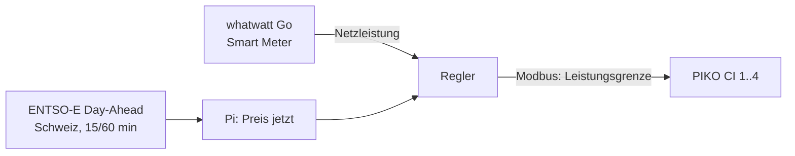

# Abregelung bei negativen Strompreisen (Feldtest PIKO CI)

Ziel: Bei negativem Day-Ahead-Preis speist die Anlage nichts ins Netz ein. Sie produziert weiter für den Eigenverbrauch («Nulleinspeisung»). Sobald der Preis wieder positiv ist, laufen die Wechselrichter wieder voll.

Feldtest-Anlage: 4 × Kostal PIKO CI 60 (240 kW), Netzanschluss gemessen mit whatwatt Go am Smart Meter des Netzbetreibers.

## Wie es funktioniert



1. Der Pi holt einmal täglich nach 13 Uhr die Preise für morgen (ENTSO-E, Gebotszone Schweiz) und speichert sie.
2. Liegt der Preis der aktuellen Viertelstunde unter der Schwelle (Standard 0 €/MWh), regelt der Pi:
   - Ziel ist ein kleiner Netzbezug (`puffer_w`, Standard 500 W), damit sicher nichts eingespeist wird.
   - Alle 10 Sekunden passt er die Gesamtgrenze an und verteilt sie nach Nennleistung auf die Wechselrichter.
3. Ist der Preis wieder positiv, setzt er alle Wechselrichter auf Nennleistung.

**Ausfallverhalten (wählbar):** Liefert der Netzzähler während negativer Preise keine Daten, hält der Pi zuerst die letzte Grenze. Nach `fallback_nach_s` (Standard 120 s) wendet er das gewählte Verhalten an:

| `fallback` | Was passiert | Wann sinnvoll |
|---|---|---|
| `halten` (Standard) | letzte Grenze bleibt, bis der Zähler zurück ist oder der Preis wieder positiv wird | meist: Ausfälle sind kurz, die Grenze stimmt ungefähr |
| `einspeisung` | alle Wechselrichter auf Nennleistung | Produktion wichtiger als die Kosten der negativen Viertelstunden |
| `aus` | alle Wechselrichter auf 0 W, auch kein Eigenverbrauch aus PV | negative Preise sehr teuer, Eigenverbrauch klein |

Dasselbe gilt, wenn der Dienst während negativer Preise beendet wird (Update, Neustart). Wird der Preis wieder positiv, gibt der Pi frei, dafür braucht er keinen Zähler. Was der **Wechselrichter** macht, wenn der Pi ganz ausfällt und keine Vorgaben mehr kommen, bestimmt seine eigene Einstellung (siehe unten, mit Kostal klären).

**Benachrichtigung:** Jeder Ausfall wird gemeldet:
- **rote Lampe** über einen Shelly (Gen1 bis Gen4) oder myStrom-Stecker, leuchtet bei kritischen Alarmen
- **Push aufs Handy** über ntfy (kostenlose App «ntfy», Thema abonnieren; öffentlicher Server ntfy.sh oder eigener)
- **E-Mail** über einen SMTP-Server (z. B. das Solarmaa-Postfach)
- **Lebenszeichen:** Der Pi meldet sich alle 5 Minuten bei einem Überwachungsdienst (z. B. healthchecks.io). Fällt der Pi selbst aus, alarmiert dieser Dienst. Der Pi kann seinen eigenen Ausfall nicht melden.

Gemeldet werden: Netzzähler fehlt während negativer Preise (kritisch), Wechselrichter nimmt Vorgabe nicht an (kritisch), Anlage liefert länger als 10 min keine Werte (kritisch), ein Gerät fällt länger als 10 min aus (Warnung), Preise fehlen (Warnung). Offene Alarme werden alle 12 h erneut gemeldet, Behebungen ebenfalls.

```toml
[benachrichtigung]
erinnerung_h = 12
lebenszeichen_url = "https://hc-ping.com/<uuid>"   # optional

[benachrichtigung.lampe]
typ = "shelly"              # oder "mystrom"
host = "192.168.1.88"
kanal = 0

[benachrichtigung.push]
server = "https://ntfy.sh"
thema = "solarmaa-kunde-xyz-7f3k"   # schwer erratbar wählen, Thema ist öffentlich

[benachrichtigung.email]
smtp_host = "mail.example.ch"
smtp_port = 587
sicherheit = "starttls"     # starttls | ssl | keine
benutzer = "pi@solarmaa.ch"
passwort = ""
absender = "pi@solarmaa.ch"
empfaenger = ["service@solarmaa.ch"]
```

Test: `python3 -m solarmaa_dash alarm-test -c /etc/solarmaa-dash/config.toml` oder in der Wartung «Testmeldung senden». Die Lampe leuchtet dabei 5 Sekunden. Im Dashboard sieht der Kunde bei einer kritischen Störung «Störung erkannt. Solarmaa wurde benachrichtigt.»

**Weitere Regeln:** Der Pi schreibt nur bei Änderungen über 1 kW oder als Lebenszeichen alle 60 s, nicht im Sekundentakt.

## Huawei-Gewerbespeicher

Ein Speicher hilft bei negativen Preisen: Er lädt den Überschuss, statt ihn abzuregeln.

- **Zusammenspiel:** Der Huawei-Speicher regelt mit seinem eigenen Zähler auf Eigenverbrauch und lädt zuerst. Die Abregelung des Pi greift nur noch für den Rest, der trotzdem ins Netz ginge. Weil beide auf den Netzanschluss regeln, beim Test darauf achten, dass sie nicht gegeneinander schwingen. Gegebenenfalls `puffer_w` erhöhen oder `verstaerkung` senken.
- **Anzeige über den SmartLogger 3000 (Modbus TCP, keine Zusatzhardware):** Profil `huawei_smartlogger_ess` liest Ladezustand (Register 37760) und Lade-/Entladeleistung (37765). Die Register stammen aus einer Community-Konfiguration für Batterien an Huawei-Wechselrichtern hinter dem SmartLogger. Ob der Gewerbespeicher (LUNA2000 C&I) dieselben Register nutzt, ist **nicht bestätigt**: bei der Inbetriebnahme mit `geraet-test` gegen die SmartLogger-Anzeige prüfen, sonst Register nach der Huawei-Datei «SmartLogger ModBus Interface Definitions» anpassen.

  ```toml
  [[geraet]]
  name = "Huawei-Speicher"
  rolle = "speicher"
  typ = "modbus_profil"
  profil = "huawei_smartlogger_ess"
  host = "192.168.1.60"       # IP des SmartLogger
  unit = 12                   # logische Adresse des Speichers im SmartLogger
  ```
  Am SmartLogger Modbus TCP aktivieren, feste IP, «Logical Addressing».
- **Alternative über die Huawei-Cloud:** FusionSolar «Northbound API» (API-Konto im FusionSolar-Portal, Gerätetyp Speicher freigeben). Sie erlaubt laut Integrationen nur etwa einen Abruf pro Minute und Endpunkt. Noch nicht gebaut; sinnvoll nur, wenn Modbus am SmartLogger nicht geht.
- **Später möglich:** Bei negativen Preisen den Speicher gezielt aus dem Netz laden (der Kunde wird dafür bezahlt). Dazu muss der Pi den SmartLogger steuern («Charge/Discharge based on grid dispatch»). Das braucht eine eigene Prüfung.

## Wichtig vor dem Feldtest

1. **PIKO-CI-Register prüfen.** Die Register stammen aus Auszügen der Kostal-Schnittstellenbeschreibung «PIKO CI Interface description KOSTAL MODBUS (TCP) with control information»:
   - `0x30B3` (12467) «Power limit function» = 1 «External device»
   - `0x3085` (12421) «Output power de-rating by Modbus command», Watt, U32

   Das vollständige PDF konnte ich nicht lesen. Vor dem ersten Schreiben mit dem aktuellen Kostal-PDF für die installierte Firmware vergleichen (`pi/solarmaa_dash/profile/kostal_piko_ci.toml`). Klären:
   - Bedeutet «External device» wirklich Steuerung über Modbus?
   - Welche Wortfolge gilt für U32?
   - Was macht der Wechselrichter, wenn kein Befehl mehr kommt?
   - Bleibt die Vorgabe nach einem Neustart des Wechselrichters erhalten?
2. **Netzbetreiber:** Bei 240 kW hat der Netzbetreiber meist eigene Vorgaben (Rundsteuerung, Leistungsreduktion). Diese haben Vorrang und dürfen nicht übersteuert werden. Den Feldtest mit dem Netzbetreiber absprechen.
3. **Tarif und Preis:** Der Kunde wird ab nächstem Jahr pro Viertelstunde vergütet bzw. belastet. Massgebend ist der Preis seines Netzbetreibers bzw. Vermarkters. Der Day-Ahead-Preis ist nur die Grundlage dafür. Weicht der Tarif ab (Zuschläge, eigene Formel), die Schwelle anpassen oder die Preise des Netzbetreibers als CSV einspielen (`preisquelle = "csv"`).
4. **ENTSO-E-Token:** Kostenlos. Konto auf transparency.entsoe.eu anlegen, dann per Mail an transparency@entsoe.eu den API-Zugang («Restful API access») beantragen. Den Token erzeugst du danach in den Kontoeinstellungen. Ob ENTSO-E die Schweizer Preise im 15- oder 60-Minuten-Raster liefert, zeigt `python3 -m solarmaa_dash preise`.
5. **whatwatt:** Kundenschnittstelle beim Netzbetreiber freischalten lassen, whatwatt mit der Rolle `netz` eintragen und mit `geraet-test` gegen die Zähleranzeige prüfen (Vorzeichen, kW/W).

## Ablauf Feldtest

| Phase | Modus | Dauer | Was passiert |
|---|---|---|---|
| 1 | `simulation` | 1–2 Wochen | Pi rechnet und protokolliert, schreibt nichts. In der Wartung prüfen: Wann hätte er abgeregelt, wie stark? |
| 2 | `test` | 1 Termin, 30 Minuten | Nur **ein** Wechselrichter in der Liste, Testfenster zu einer sonnigen Zeit (z. B. `"2026-11-20 12:00-12:30"`). Vor Ort: Leistung sinkt, Netz ≈ 0, danach Freigabe. |
| 3 | `test` | 1 Termin | Alle vier Wechselrichter, gleiches Vorgehen |
| 4 | `auto` | Dauerbetrieb | Abregelung nach Day-Ahead-Preis |

Nach jeder Phase das Protokoll unter Wartung → «Abregelung» anschauen.

## Konfiguration

```toml
[[geraet]]
name = "Smart Meter"
rolle = "netz"
typ = "whatwatt"
host = "192.168.1.70"

# Lesen der PV-Leistung (z. B. SunSpec, falls die Erkennung die PIKO CI findet)
# [[geraet]] ... rolle = "pv"

[abregelung]
modus = "simulation"          # aus | simulation | test | auto
preisquelle = "entsoe"        # entsoe | csv | keine
entsoe_token = ""             # nur in /etc/solarmaa-dash/config.toml, nie ins Repository
schwelle = 0.0                # abregeln, wenn Preis < schwelle (ENTSO-E: EUR/MWh)
puffer_w = 500                # gewünschter kleiner Netzbezug während der Abregelung
test_fenster = []             # z. B. ["2026-11-20 12:00-12:30"]

[[abregelung.wechselrichter]]
name = "PIKO CI 60 – 1"
host = "192.168.1.81"
port = 502
unit = 1
nennleistung_w = 60000
profil = "kostal_piko_ci"
# … gleich für 2, 3, 4
```

Weitere Einstellungen: `fallback` (halten | einspeisung | aus), `fallback_nach_s` (120), `verstaerkung` (0.6), `schritt_s` (10), `min_aenderung_w` (1000).

## Befehle

```bash
python3 -m solarmaa_dash preise -c /etc/solarmaa-dash/config.toml     # Preise heute/morgen, markiert Abregelzeiten
python3 -m solarmaa_dash geraet-test -c /etc/solarmaa-dash/config.toml
python3 -m solarmaa_dash alarm-test -c /etc/solarmaa-dash/config.toml  # Lampe, Push, E-Mail testen
journalctl -u solarmaa-dash | grep Abregelung
```

## Quellen

- [Kostal PIKO CI Modbus-Beschreibung](https://www.kostal-solar-electric.com/fileadmin/downloadcenter/kse/BA/Protokollbeschreibung/BA_PIKO-CI_KOSTAL-Interface-description-Modbus-Sunspec.pdf) (Registerauszüge über Suchergebnisse)
- [Kostal PIKO IQ/Plenticore Modbus mit Steuerung](https://www.kostal-solar-electric.com/fileadmin/downloadcenter/kse/BA/Protokollbeschreibung/BA_KOSTAL_Interface_MODBUS-TCP_SunSpec_with_Control.pdf)
- [ENTSO-E API, Day-Ahead-Preise A44](https://apis.io/apis/entso-e/entso-e-market-data-query-api/), [evcc ENTSO-E](https://docs.evcc.io/en/tariffs/entso-e)
- [ntfy: Nachrichten senden](https://docs.ntfy.sh/publish/), [Shelly Gen2 Switch](https://shelly-api-docs.shelly.cloud/gen2/ComponentsAndServices/Switch/)
- [Huawei LUNA2000 C&I mit SmartLogger 3000 (Handbuch)](https://ske-solar.com/fileadmin/user_upload/UserManual_LUNA2000-_107-241__C_I-On-Grid-SmartLogger3000_V10_2026-03-30_EN.pdf), [SmartLogger 3000 Modbus (Community)](https://github.com/theyo-tester/ha-smartlogger3000-modbus-config/blob/main/README.md)
- [Swissolar: Was gilt 2026 für PV](https://www.swissolar.ch/de/news/detail/2026-was-gilt-neu-fuer-photovoltaikanlagen-80786)
