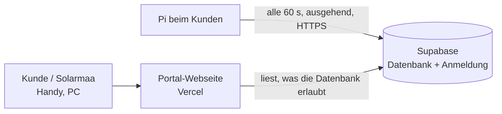

# Solarmaa-Portal (Stufen 1 und 3)

Zentrale Webseite für alle Anlagen: Solarmaa sieht jede Anlage mit Status und Störungen, Kunden sehen ihre eigene, von überall, mit HTTPS und ohne App-Installation.



- **Pi → Portal:** Der Pi meldet sich von sich aus (keine Portfreigabe beim Kunden) und schickt Messwert, Tagessummen, Störungen und Abregelstatus. Ohne Internet läuft vor Ort alles weiter, das Portal zeigt «offline».
- **Zugriff:** Die Datenbank prüft jede Zeile (Row Level Security). Solarmaa-Konten sehen alle Anlagen, Kunden nur zugeordnete, alle anderen nichts. Geprüft in einer lokalen Postgres-Datenbank mit denselben Regeln.
- **Pi-Token:** Jede Anlage hat einen geheimen Token. Gespeichert ist nur sein Hash. Geht ein Pi verloren, im Portal «Neuen Pi-Token erzeugen».

- **Fernwartung (Stufe 3):** Solarmaa-Konten mit Zwei-Faktor-Anmeldung können pro Anlage ein Update auslösen und die Konfiguration ändern, sofern die Fernwartung auf dem Pi eingeschaltet ist. Siehe Kapitel «Fernwartung» unten.

Noch nicht gebaut: Hausansicht und Rechnungen im Portal, Alarm an Solarmaa bei ausbleibendem Pi (Stufe 2).

> **Stand der Stufe 3:** entwickelt und gegen lokale Datenbank und Attrappe geprüft, aber **noch nicht ausgeliefert**. Weder das Supabase-Projekt noch das veröffentlichte Portal noch ein Pi im Feld haben diesen Stand, bis er freigegeben und in der Reihenfolge unter «Auslieferung der Stufe 3» eingespielt ist.

## Stand (13.11.2026)

- Portal: **https://solarmaa-portal.vercel.app** (Vercel-Projekt `solarmaa-portal`, Team tisch1, verbunden mit diesem Repository, Ordner `portal/web`; jeder Push auf den Hauptbranch veröffentlicht neu).
- Supabase-Projekt SolarmaaPortal: Struktur eingespielt, offene Registrierung aus, Passwort-Mindestlänge 10, Portal-Adresse als Site URL gesetzt, ein Solarmaa-Admin eingetragen.
- Die Schritte 1 bis 4 unten sind damit erledigt und dienen als Nachschlagewerk.

## Einrichtung (einmalig)

### 1. Datenbankstruktur einspielen

Supabase → Projekt «SolarmaaPortal» → **SQL Editor** → «New query» → den ganzen Inhalt von [`portal/supabase/schema.sql`](../portal/supabase/schema.sql) einfügen → **Run**. Erwartet: «Success. No rows returned». Das Skript kann gefahrlos mehrfach ausgeführt werden.

### 2. Anmeldung absichern

Supabase → **Authentication**:
- **Sign In / Providers → Email:** «Allow new users to sign up» **ausschalten**. Sonst kann sich jeder ein Konto anlegen. Er sähe zwar keine Daten, soll aber gar nicht erst hineinkommen.
- **URL Configuration → Site URL:** die Adresse des Portals eintragen (z. B. `https://portal.solarmaa.ch`). Dorthin führen die Links in Einladungs- und Passwort-E-Mails.
- Passwort-Mindestlänge auf 10 stellen, «Leaked password protection» einschalten, falls im Plan enthalten.

### 3. Erstes Solarmaa-Konto

- Authentication → **Users → Add user → Create new user**: eigene E-Mail und ein Passwort, «Auto Confirm User» an.
- Dann im SQL Editor (E-Mail anpassen):

  ```sql
  insert into public.admins (user_id) select id from auth.users where email = 'deine.adresse@solarmaa.ch';
  ```

Weitere Solarmaa-Konten genauso. Kunden werden **nicht** in `admins` eingetragen.

### 4. Portal-Webseite veröffentlichen (Vercel)

- Neues Vercel-Projekt aus diesem Repository, **Root Directory: `portal/web`**, Framework «Other», kein Build-Befehl.
- Domain `portal.solarmaa.ch` zuweisen (DNS-Eintrag laut Vercel).
- Die Seite enthält nur den öffentlichen Supabase-Schlüssel (`portal/web/config.js`). Geheime Schlüssel braucht sie nicht.

## Anlage anbinden

1. Im Portal als Solarmaa anmelden → **Anlage hinzufügen** (Name, Ort, kWp).
2. Das Portal zeigt einmalig einen Block:

   ```toml
   [portal]
   url = "https://….supabase.co"
   schluessel = "sb_publishable_…"
   token = "…"
   fernwartung = true
   ```

   Die Zeile `fernwartung = true` erlaubt die Fernwartung dieser Anlage (Entscheid E7). Wer sie weglässt oder auf `false` setzt, schaltet die Fernwartung aus; das geht nur vor Ort. `pi/portal-verbinden.sh` trägt die Zeile ebenfalls ein.
3. Auf dem Pi: Wartung → Konfiguration → Laden → Block ans Ende einfügen → Speichern. Nach etwa einer Minute erscheint die Anlage im Portal als «online».

## Kunde freischalten

1. Supabase → Authentication → Users → **Invite user** (E-Mail des Kunden). Der Kunde erhält einen Link und setzt sein Passwort im Portal.
2. Im Portal die Anlage öffnen → «Zugriff für Kunden» → E-Mail eintragen → **Zugriff geben**.

Zugriff entziehen: gleiche Stelle, «Entfernen».

## Fernwartung (Stufe 3)

Grundlage sind die Entscheide E6 und E7 in [`ENTSCHEIDE.md`](ENTSCHEIDE.md).

### Wer darf was

- **Einschalten** lässt sich die Fernwartung nur auf dem Pi: `[portal] fernwartung = true`. Standard ist aus. Der Pi meldet den Schalter dem Portal; ist er aus, nimmt die Datenbank keine Befehle für die Anlage an und der Pi führt keine aus.
- **Befehle senden, Konfiguration lesen, «Neuen Pi-Token erzeugen», Anlage löschen:** nur Solarmaa-Konten (`admins`), deren Sitzung mit dem zweiten Faktor bestätigt ist. Das prüft die Datenbank, nicht die Webseite.
- Kunden und fremde Konten sehen weder Befehle noch Konfiguration.
- Es gibt genau zwei Befehle: **Update** und **Konfiguration**. Kein Befehl schreibt direkt auf ein Gerät.

### Was aus der Ferne änderbar ist

Die ganze Konfiguration, auch `[abregelung]`, `[benachrichtigung]` und `[haus]`. **Nur vor Ort** änderbar bleiben:

- `[portal]`, `[server]`, `[daten]` (sonst könnte man sich aussperren, auch den Schalter `fernwartung` selbst),
- der Wechsel in den Demo-Modus (`quelle.typ = "demo"` bzw. das Entfernen aller Geräte bei `typ = "demo"`, `[haus] demo = true`; siehe Lücke L7).

Lokal wie aus der Ferne gilt ausserdem: `profil` ist immer der **Name** eines mitgelieferten Profils (Kleinbuchstaben, Ziffern, `_`), nie ein Pfad; und neue oberste Abschnitte, die das Programm nicht kennt, werden abgelehnt.

Geheime Werte (Passwörter, Tokens, API-Keys, ntfy-Thema, Lebenszeichen-Adresse) verlassen den Pi nie: Im Portal stehen sie als `********` und bleiben beim Speichern erhalten. Wer in einem Abschnitt etwas ändert, der ein solches verdecktes Geheimnis enthält (z. B. `host` oder `basis_url`), muss das Geheimnis neu eintippen. Das gilt auch, wenn Einträge wie `[[geraet]]` verschoben, eingefügt oder gelöscht werden (die Zuordnung läuft über die Reihenfolge). So kann niemand ein gespeichertes Passwort an eine andere Adresse schicken lassen. Mehrzeilige Zeichenketten (`'''`, `"""`) nimmt der Pi über das Portal nicht an. Steht ein Geheimnis in einer Form in der Datei, die sich nicht verdecken lässt (einfache Anführungszeichen, mehrzeilig), überträgt der Pi die Konfiguration gar nicht und schreibt eine Warnung ins Protokoll (`journalctl -u solarmaa-dash`; auch in `/api/wartung`, Feld `portal.konfig_hinweis`).

### Ablauf und Zustände

1. Im Portal die Anlage öffnen → Karte **Fernwartung** → Zwei-Faktor bestätigen.
2. «Update auslösen» oder «Konfiguration laden», bearbeiten, «Konfiguration senden» (jeweils mit Bestätigung).
3. Der Pi holt den Befehl bei seiner nächsten Meldung ab (etwa eine Minute), prüft ihn selbst und führt ihn höchstens einmal aus.
4. Das Ergebnis erscheint unter «Letzte Befehle».

| Anzeige | Bedeutung |
|---|---|
| wartet auf den Pi | angelegt, noch nicht abgeholt. Nach einer Stunde: **verfallen** |
| abgeholt, läuft | der Pi hat den Befehl. Die Nutzlast ist ab jetzt in der Datenbank gelöscht |
| erledigt | Konfiguration: der Dienst läuft nach dem Neustart mit der neuen Fassung. Update: das Update-Protokoll meldet «OK» oder «Bereits aktuell» |
| fehler | abgelehnt oder fehlgeschlagen, mit Begründung des Pi |
| keine Quittung | abgeholt, aber seit 45 Minuten keine Antwort (Pi offline, Stromausfall). Eine späte Quittung kommt noch an |

Der Pi lehnt ab: bei ausgeschalteter Fernwartung, **während einer Abregelung** (auch im Modus `simulation`) und solange danach die Freigabe eines Wechselrichters aussteht (Zustand nach dem Start unbekannt, letzte Vorgabe unter Nennleistung oder Schreibfehler), solange ein anderer Befehl läuft, ab dem siebten Befehl in einer Stunde, bei ungültiger Konfiguration, bei einer Änderung an gesperrten Abschnitten und wenn die Konfiguration auf dem Pi seit dem Laden im Portal geändert wurde («neu laden»).

Fristen: Befehl verfällt nach 1 Stunde; fehlender Neustart wird nach 5 Minuten, fehlendes Update-Ergebnis nach 20 Minuten als Fehler quittiert. Wie lange ein Update auf einem echten Pi dauert, ist nicht gemessen.

Startet der Dienst mit einer aus der Ferne gespeicherten Konfiguration nicht, spielt er die vorherige Fassung zurück und meldet das als Fehler. Ein Fehler, der erst später im Betrieb auftritt, wird nicht automatisch zurückgesetzt. Jede vorherige Fassung liegt auf dem Pi unter `/var/lib/solarmaa-dash/config-sicherung` (`…-portal.toml`).

### Zwei-Faktor einrichten

- Supabase → **Authentication → Multi-Factor**: TOTP («Authenticator App») muss eingeschaltet sein. **Am Projekt prüfen**, von der Entwicklungsumgebung aus nicht sichtbar.
- Im Portal: Anlage öffnen → Fernwartung → «Zwei-Faktor einrichten» → QR-Code mit einer Authenticator-App scannen → Code eingeben. Bei jeder neuen Anmeldung wird der Code einmal verlangt.
- Die Ersteinrichtung ist «wer zuerst kommt»: Wer das Passwort eines Solarmaa-Kontos ohne eingerichteten Faktor kennt, kann selbst einen einrichten. Darum richten **alle** Solarmaa-Konten den Faktor ein, sobald die neue Portal-Seite veröffentlicht ist, und **bevor** auf der ersten Anlage `fernwartung = true` steht.
- Faktor verloren: in Supabase unter Authentication → Users beim Konto den Faktor entfernen, dann neu einrichten.

### Auslieferung der Stufe 3 (Reihenfolge einhalten)

1. `portal/supabase/schema.sql` im Supabase-Projekt einspielen. Die bisherige Portal-Seite und Pis mit Version 1.5.0 laufen damit unverändert weiter (geprüft mit `tests/portal/run.sh`, Abschnitt «Bestehende Datenbank hochziehen»). Ab jetzt verlangt «Neuen Pi-Token erzeugen» den zweiten Faktor.
2. Pi-Stand 1.6.0 auf `stabil`. Ein Pi 1.6.0 verträgt auch die alte Datenbank.
3. Portal-Seite veröffentlichen. Sie braucht die neue Datenbank (Spalte `fernwartung`); in umgekehrter Reihenfolge bliebe die Anlagenliste leer.
4. **Sofort danach** richten alle Solarmaa-Konten ihren zweiten Faktor ein (das geht erst mit der neuen Seite).
5. Erst dann pro Anlage `fernwartung = true` eintragen (vor Ort oder per VPN), wenn der Kunde der Fernwartung zugestimmt hat. Achtung: Der Block, den das Portal beim Anlegen zeigt, und `pi/portal-verbinden.sh` enthalten die Zeile bereits.

## Vor dem Start mit echten Kunden

- Supabase: bezahlten Plan prüfen (Sicherungen, kein Stilllegen bei Inaktivität), Region bestätigen.
- Auftragsverarbeitungsverträge mit Supabase und Vercel abschliessen, Datenschutzerklärung ergänzen.
- Eigenen E-Mail-Versand (SMTP) in Supabase hinterlegen: Der eingebaute Versand ist stark begrenzt und nur zum Testen gedacht.
- Zwei-Faktor-Anmeldung für **alle** Solarmaa-Konten einrichten, bevor Stufe 3 eingespielt wird (siehe «Auslieferung der Stufe 3»).
- Auftragsverarbeitung: Bei eingeschalteter Fernwartung liegt die maskierte Konfiguration der Anlage in Supabase (IP-Adressen im Hausnetz, Benutzernamen, E-Mail-Adressen, Namen der Einheiten; keine Passwörter).

## Geprüft und nicht geprüft

Geprüft (alles lokal, siehe [`tests/portal/README.md`](../tests/portal/README.md)):

- Datenbankstruktur und Zugriffsregeln der Stufen 1 und 3 in einer lokalen Postgres-Datenbank, als neue Datenbank, wiederholt eingespielt und als Upgrade vom Stand der Stufe 1 (`tests/portal/run.sh`).
- Ablauf Pi ↔ Portal mit dem echten Pi-Code gegen eine Supabase-Attrappe: abholen, ausführen, quittieren, Konfiguration hochladen; neuer Pi an alter Datenbank.
- Portal-Seite im Handy-Format gegen die Attrappe: Zwei-Faktor einrichten und bestätigen, Konfiguration laden und senden, Update, Ablehnungen, Rollen, Abmelden (`tests/portal/run.sh --browser`).
- Regeln des Pi für Fernbefehle als Unittests (`tests/test_fernwartung.py`), Geräte und Update-Lauf simuliert.

Nicht geprüft (nur an der echten Umgebung möglich):

- Das echte Supabase-Projekt: Login, Einladungs- und Passwort-Links, `auth.jwt()` und die Standardrechte.
- Die **Zwei-Faktor-Schnittstelle von Supabase** (`/auth/v1/factors`, `…/challenge`, `…/verify`, Faktorenliste in `/auth/v1/user`, Feldnamen `totp.qr_code`, `totp.secret`, `challenge_id`): nach der Dokumentation der Auth-API gebaut, gegen eine Attrappe geprüft. Ebenso, ob TOTP im Projekt eingeschaltet ist und ob die Stufe `aal2` eine Token-Erneuerung übersteht.
- PostgREST im Detail (Antwort auf Funktionen ohne Rückgabewert, HTTP-Status bei abgelehnten Aufrufen) und die Inhalts-Sicherheitsrichtlinie auf Vercel mit dem QR-Bild.
- Fernwartung an einem echten Pi: Update über die systemd-Path-Unit, Dauer, Lesbarkeit des Update-Protokolls, Neustart und Rückfall unter systemd, Übergang 1.5.0 → 1.6.0, Zusammenspiel mit einer echten Abregelung.
