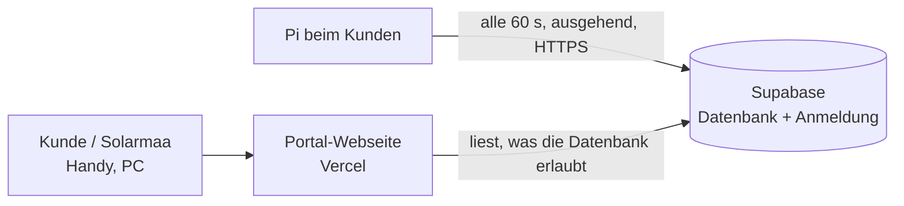

# Solarmaa-Portal (Stufe 1)

Zentrale Webseite für alle Anlagen: Solarmaa sieht jede Anlage mit Status und Störungen, Kunden sehen ihre eigene, von überall, mit HTTPS und ohne App-Installation.



- **Pi → Portal:** Der Pi meldet sich von sich aus (keine Portfreigabe beim Kunden) und schickt Messwert, Tagessummen, Störungen und Abregelstatus. Ohne Internet läuft vor Ort alles weiter, das Portal zeigt «offline».
- **Zugriff:** Die Datenbank prüft jede Zeile (Row Level Security). Solarmaa-Konten sehen alle Anlagen, Kunden nur zugeordnete, alle anderen nichts. Geprüft in einer lokalen Postgres-Datenbank mit denselben Regeln.
- **Pi-Token:** Jede Anlage hat einen geheimen Token. Gespeichert ist nur sein Hash. Geht ein Pi verloren, im Portal «Neuen Pi-Token erzeugen».

Noch nicht in Stufe 1: Hausansicht und Rechnungen im Portal (Stufe 2), Fernkonfiguration und Updates über das Portal (Stufe 3), Zwei-Faktor-Anmeldung.

## Stand (13.11.2026)

- Portal: **https://solarmaa-portal.vercel.app** (Vercel-Projekt `solarmaa-portal`, Team tisch1, verbunden mit diesem Repository, Ordner `portal/web`; jeder Push auf den Hauptbranch veröffentlicht neu).
- Supabase-Projekt SolarmaaPortal: Struktur eingespielt, offene Registrierung aus, Passwort-Mindestlänge 10, Portal-Adresse als Site URL gesetzt, ein Solarmaa-Admin eingetragen.
- Die Schritte 1 bis 4 unten sind damit erledigt und dienen als Nachschlagewerk.

## Einrichtung (einmalig)

### 1. Datenbankstruktur einspielen

Supabase → Projekt «SolarmaaPortal» → **SQL Editor** → «New query» → den ganzen Inhalt von [`portal/supabase/schema.sql`](../portal/supabase/schema.sql) einfügen → **Run**. Erwartet: «Success. No rows returned». Das Skript kann gefahrlos mehrfach ausgeführt werden.

### 2. Anmeldung absichern

Supabase → **Authentication**:
- **Sign In / Providers → Email:** «Allow new users to sign up» **ausschalten**. Sonst kann sich jeder ein Konto anlegen. Er sähe zwar keine Daten, soll aber gar nicht erst hineinkommen.
- **URL Configuration → Site URL:** die Adresse des Portals eintragen (z. B. `https://portal.solarmaa.ch`). Dorthin führen die Links in Einladungs- und Passwort-E-Mails.
- Passwort-Mindestlänge auf 10 stellen, «Leaked password protection» einschalten, falls im Plan enthalten.

### 3. Erstes Solarmaa-Konto

- Authentication → **Users → Add user → Create new user**: eigene E-Mail und ein Passwort, «Auto Confirm User» an.
- Dann im SQL Editor (E-Mail anpassen):

  ```sql
  insert into public.admins (user_id) select id from auth.users where email = 'deine.adresse@solarmaa.ch';
  ```

Weitere Solarmaa-Konten genauso. Kunden werden **nicht** in `admins` eingetragen.

### 4. Portal-Webseite veröffentlichen (Vercel)

- Neues Vercel-Projekt aus diesem Repository, **Root Directory: `portal/web`**, Framework «Other», kein Build-Befehl.
- Domain `portal.solarmaa.ch` zuweisen (DNS-Eintrag laut Vercel).
- Die Seite enthält nur den öffentlichen Supabase-Schlüssel (`portal/web/config.js`). Geheime Schlüssel braucht sie nicht.

## Anlage anbinden

1. Im Portal als Solarmaa anmelden → **Anlage hinzufügen** (Name, Ort, kWp).
2. Das Portal zeigt einmalig einen Block:

   ```toml
   [portal]
   url = "https://….supabase.co"
   schluessel = "sb_publishable_…"
   token = "…"
   ```
3. Auf dem Pi: Wartung → Konfiguration → Laden → Block ans Ende einfügen → Speichern. Nach etwa einer Minute erscheint die Anlage im Portal als «online».

## Kunde freischalten

1. Supabase → Authentication → Users → **Invite user** (E-Mail des Kunden). Der Kunde erhält einen Link und setzt sein Passwort im Portal.
2. Im Portal die Anlage öffnen → «Zugriff für Kunden» → E-Mail eintragen → **Zugriff geben**.

Zugriff entziehen: gleiche Stelle, «Entfernen».

## Vor dem Start mit echten Kunden

- Supabase: bezahlten Plan prüfen (Sicherungen, kein Stilllegen bei Inaktivität), Region bestätigen.
- Auftragsverarbeitungsverträge mit Supabase und Vercel abschliessen, Datenschutzerklärung ergänzen.
- Eigenen E-Mail-Versand (SMTP) in Supabase hinterlegen: Der eingebaute Versand ist stark begrenzt und nur zum Testen gedacht.
- Zwei-Faktor-Anmeldung für Solarmaa-Konten (folgt mit Stufe 2/3, spätestens bevor das Portal Anlagen steuern kann).

## Geprüft und nicht geprüft

- Geprüft: Datenbankstruktur und Zugriffsregeln in lokaler Postgres-Datenbank; Portal-Seite auf Handy-Grösse gegen diese Datenbank mit drei Rollen; Pi meldet Daten.
- Nicht geprüft: das echte Supabase-Projekt (von der Entwicklungsumgebung nicht erreichbar), der echte Supabase-Login samt Einladungs- und Passwort-Links, Vercel-Auslieferung.
